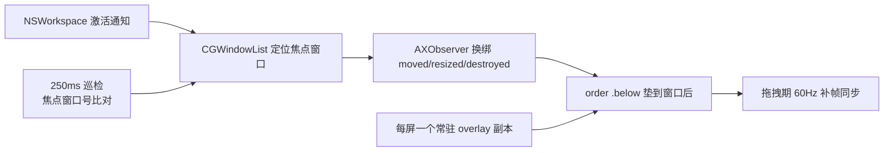

# WindowBGFollow

 macOS 窗口背后跟随图片工具：让一张背景图实时「贴」在当前焦点窗口背后，随窗口切换、拖动、缩放同步，为窗口提供可被透出的背景层（Liquid Glass 观感）。

原生 Swift 实现，单可执行文件，菜单栏常驻，无需 Xcode 工程。

## 功能特性

- **精确 z-order 垫底**：通过 `NSWindow.order(.below, relativeTo:)` 把背景垫到焦点窗口正后方——目标窗口被其他窗口盖住时，背景也跟着被盖住（真配对关系，非桌面壁纸式近似）
- **实时跟随**：App 切换 / 窗口拖动 / 缩放逐帧同步；AX 事件 + 拖拽期 60Hz 补帧双通道
- **每屏常驻副本**：每个显示器维护一个独立的背景 overlay，永不跨屏移动，切换显示器零闪现
- **快速响应关闭**：AX 销毁通知 + 250ms 焦点巡检兜底，关闭窗口背景残留 ≤250ms
- **低资源占用**：CPU 静止基线 ~0.7%，图片按 720p 基线降采样解码
- **可配置**：背景图与 app 白/黑名单均为 app 目录下的独立文件，改完即生效（配置热生效）

## 运行原理



| 模块 | 机制 |
|---|---|
| 目标定位 | `CGWindowListCopyWindowInfo` 过滤 layer 0 + 前台 app PID |
| 垫底排序 | `NSWindow.order(.below, relativeTo: 窗口号)`（窗口号全局有效，跨进程） |
| 移动跟随 | `AXObserver` 订阅 `AXWindowMoved/Resized`；拖拽期间 `leftMouseDragged` 触发 60Hz 补帧 |
| 关闭检测 | `AXUIElementDestroyed` 通知 + 250ms 巡检比对「前台 app 焦点窗口号」 |
| 跨屏防闪 | 按屏维护 overlay 副本（frame 恒落本屏内），切屏 = 换副本，无跨屏位移 |
| 权限 | 仅需辅助功能授权（读焦点窗口 frame 不需要屏幕录制权限） |

## 环境要求

- macOS 12.0+（在 macOS 26 Tahoe 上开发验证）
- Swift 5.9+（Command Line Tools 即可，无需完整 Xcode）
- 辅助功能授权（首次运行系统会弹窗引导）

## 构建与运行

```bash
git clone <repo-url> && cd WindowBGFollow
./build.sh
open WindowBGFollow.app
```

首次运行在 **系统设置 → 隐私与安全性 → 辅助功能** 中勾选 WindowBGFollow。

## 配置

### 背景图

将图片放到 app 所在目录（与 `WindowBGFollow.app` 并排），命名为：

```
WindowBGFollow/
├── WindowBGFollow.app
├── bg.jpg        ← 背景图（支持 bg.jpg / bg.jpeg / bg.png，优先级从左到右）
└── config.json   ← app 过滤配置（可选）
```

- 启动时加载一次，按 720p 基线（最长边 1280px）降采样解码，替换图片后重启 app 生效
- 渲染方式为 aspect-fill 裁剪填充 + 26px 圆角（对齐 macOS 26 窗口圆角）

### app 过滤（config.json）

```json
{
  "whitelist": [],
  "blacklist": ["com.tencent.wechat"]
}
```

| 字段 | 语义 |
|---|---|
| `whitelist` | 非空时**仅**列表内的 app 生效 |
| `blacklist` | 白名单为空时，跳过列表内的 app |
| 留空 | 两个列表都空 = 对所有 app 生效 |

- 值为 app 的 **bundle id**，查询方式：`osascript -e 'id of app "应用名"'`
- 修改后约 250ms 内热生效，无需重启

## 已知边界（系统级硬限制）

| 场景 | 表现 | 原因 |
|---|---|---|
| 不透明窗口（Chrome/Finder 等） | 整图被盖住，仅窗口圆角缺口透出背景 | 窗口不透明是 app 自身属性，外部无法穿透 |
| 关闭残留 | 极端情况最长 250ms | 部分 app 不发 `AXUIElementDestroyed`，靠巡检兜底 |
| 拖动流畅度 | 落后合成 1~2 帧 | WindowServer 合成帧率是所有追踪类工具的物理极限 |

## 目录结构

```
WindowBGFollow/
├── main.swift        # 全部实现（~380 行）
├── Info.plist        # LSUIElement 菜单栏应用声明
├── build.sh          # swiftc 编译 + ad-hoc 签名 + 打包 .app
├── Resources/bg.jpg  # 默认背景图（打包进 bundle）
├── README.md
└── README.html       # 本文档的网页版
```

## 实现备忘（给维护者）

- `AXUIElementGetWindow` 未暴露给 Swift，通过 `dlsym` 从 ApplicationServices/HIServices 动态加载，符号缺失时安全降级
- macOS 26 SDK 的 `AXUIElementCopyAttributeValue` 已改为 3 参数签名（去掉 error 指针）
- `AXObserver` 必须强持有并手动挂 RunLoop source，retarget 时移除旧 source，否则回调静默死亡
- `showOverlay` 只允许 `order(.below, relativeTo:)` 显示，禁止 `orderFront`（会把 overlay 抬到所有窗口之上造成全屏闪现）

## License

MIT
